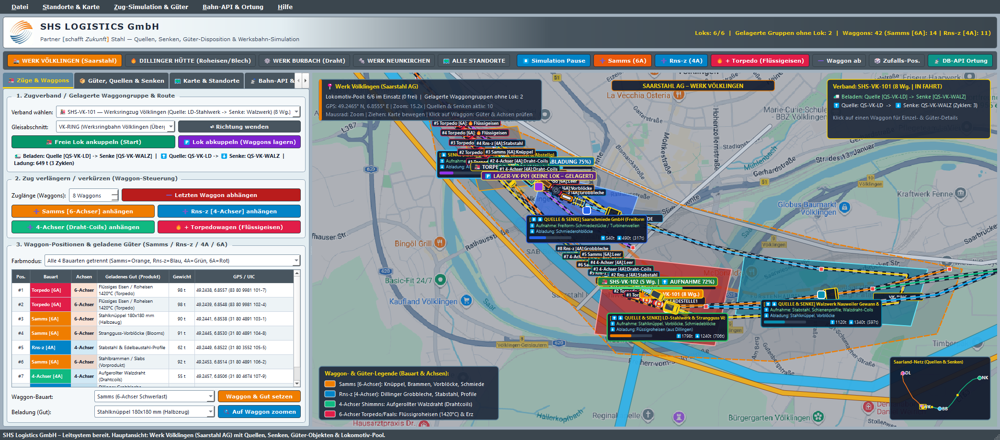
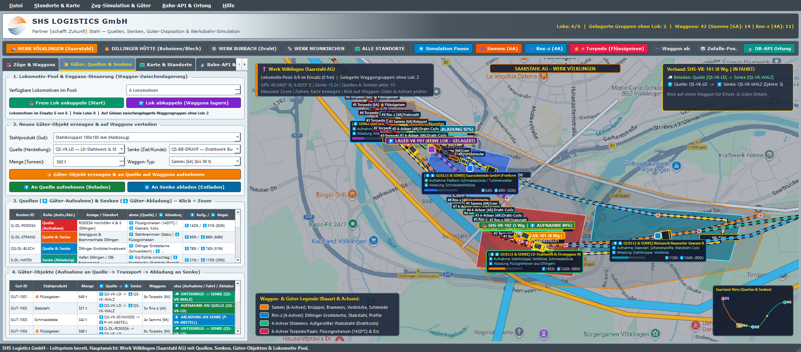
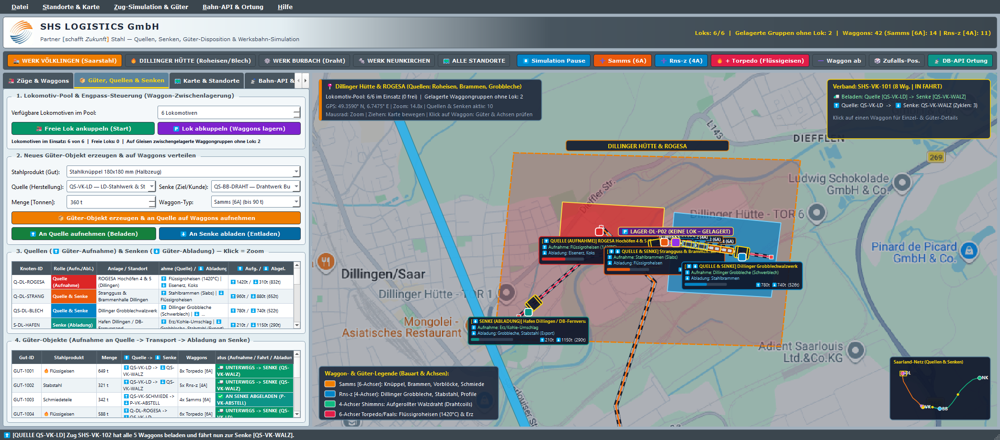
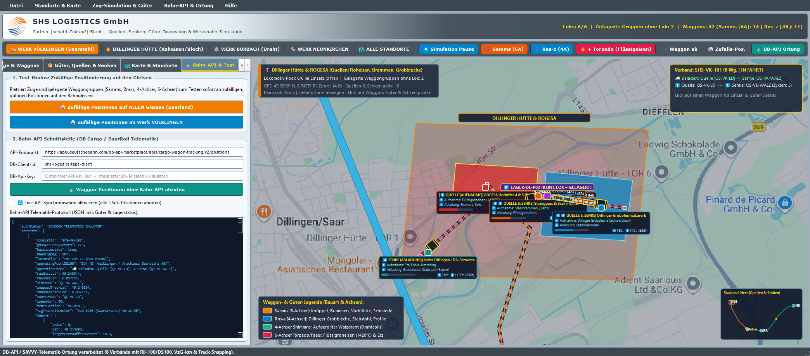
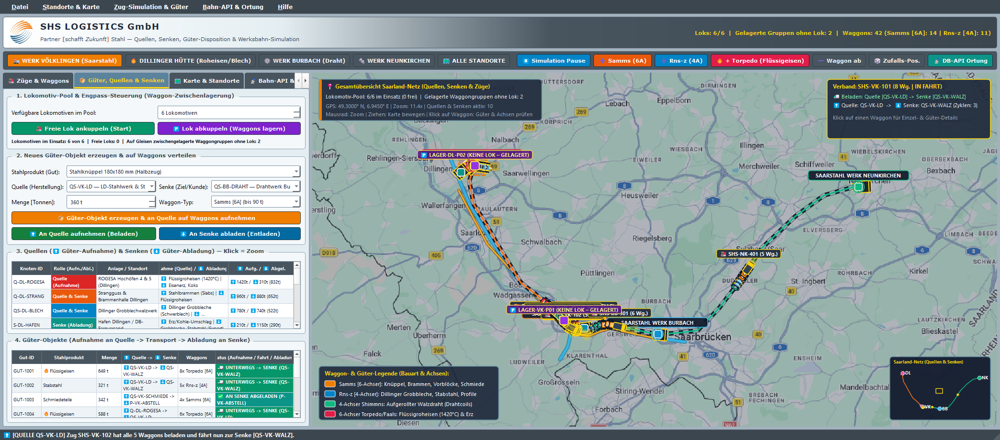

# SHS Logistics GmbH – Technisches Handbuch & GUI-Bedienungsanleitung

**Projekt:** `SHS_LOGISTICS` – Interaktives 2D-Werksbahn-, Waggon-, Güter-, Quellen/Senken- & Bahn-API-Leitsystem  
**Software-Version:** **0.8**  
**Wissenschaftliche Leitung & Software-Entwicklung:** **Frank U. Rückert**  
**Kontakt / E-Mail:** [`frank.rueckert@htwsaar.de`](mailto:frank.rueckert@htwsaar.de)  
**Institution:** htw saar – Hochschule für Technik und Wirtschaft des Saarlandes (Fakultät für Ingenieurwissenschaften)  
**Kooperationspartner & Corporate Design:** SHS Logistics GmbH (Stahl-Holding-Saar), Werkstraße 1, 66763 Dillingen/Saar – *„Partner [schafft Zukunft] Stahl“*  
**Technologie-Stack:** C++17, Qt 6.9.0 (`Qt6::Widgets`, `Qt6::Network`, `Qt6::PrintSupport`), MinGW 13.1.0 64-Bit, CMake + Ninja, Nullsoft NSIS 3.13 (Installer `setup_SHS_Logistics.exe`)

---

## Inhaltsverzeichnis
1. Überblick & Autorschaft
2. Logistische & metallurgische Grundlagen der Saar-Stahlindustrie
3. Wie das Programm funktioniert (Technische Funktionsweise)
   - 3.1 Hybride 2D-Karten-Engine
   - 3.2 2D-Eisenbahnsimulation, Waggon-Geometrie & Torpedowagen
   - 3.3 Der 4-Phasen-Logistikzyklus: Quellen & Senken
   - 3.4 Lokomotiv-Pool, Lok-Engpass & Waggon-Zwischenlagerung
   - 3.5 Funktionsweise & Realitätsgrad der Bahn-API
4. Schritt-für-Schritt-Bedienungsanleitung: Wie man das GUI benutzt
   - 4.1 – 4.8 Hauptfenster, Steuerleiste, Karte, Tabs 1–4, Tastenkürzel
5. Projektdateien, Kompilieren, Starten & Öffnen in Qt Creator
6. Installation & Weitergabe (Nullsoft NSIS Setup)
7. Hilfe-Menü & Direkte Handbuch-Verknüpfung
8. Wissenschaftliche Leitung, Entwicklung & Kontakt

---

## 1. Überblick & Autorschaft

Das Software-Tool **SHS_LOGISTICS** wurde unter der wissenschaftlichen Leitung und Entwicklung von **Frank U. Rückert** ([frank.rueckert@htwsaar.de](mailto:frank.rueckert@htwsaar.de), htw saar) für die **SHS Logistics GmbH** konzipiert und realisiert. Es dient der operativen Überwachung, Disposition und Simulation des Schwerlast- und Werksbahnverkehrs der saarländischen Stahlindustrie:

- **Hauptfokus Saarstahl-Werk Völklingen:** In der Bildschirmmitte zeigt ein großer interaktiver 2D-Kartenbildschirm die Stadt **Völklingen** auf Basis von **Google Maps** kombiniert mit einer gut sichtbaren, **vereinfachten schematischen Werksdarstellung** (Werksgrenze, LD-Stahlwerk, Stranggussanlage, Walzwerk Nauweiler Gewann, Saarschmiede, Übergabebahnhof, Ladestelle 1, Flüsse Saar & Rossel, Straßen A620, B51 & Werksstraßen sowie sämtliche Werksbahngleise).
- **Standort-Vernetzung im Saarland:** Per Mausklick oder Funktionstaste (`F1`–`F5`) kann stufenlos zwischen dem **Werk Völklingen**, der **Dillinger Hütte & ROGESA** (Roheisen- & Brammen-Erzeugung, Grobblechwalzwerk, Hafen Dillingen), dem **Saarstahl-Werk Burbach** (Drahtwerk) und dem **Saarstahl-Werk Neunkirchen** (Qualitäts-/Edelbaustahl-Walzwerk) sowie der **Gesamtübersicht Saarland-Korridor** gewechselt werden.
- **2D-Eisenbahnsimulation mit dynamischer Zugkonfiguration:** Züge und Waggons bewegen sich maßstäblich auf den Gleisen, lassen sich im laufenden Betrieb jederzeit **verlängern (`+ Waggon`)** oder **verkürzen (`- Waggon`)**, und jede Waggonposition (`#1`, `#2`, ...) wird nach Bauart (**`Samms`**, **`Rns-z`**, **`4-Achser Shimmns`**, **`6-Achser Torpedowagen`**) und Achsanzahl (**4 Achsen vs. 6 Achsen**) farblich und geometrisch unterschieden.
- **Quellen (`⬆️ Güter-Aufnahme`), Senken (`⬇️ Güter-Abladung`), Güter-Objekte & Torpedowagen (1420 °C):** Züge nehmen an den Produktions-Quellen Stahlprodukte auf (Flüssigroheisen mit 1420 °C im Torpedowagen, Brammen, Dillinger Grobbleche, Knüppel, Vorblöcke, aufgerollten Walzdraht/Coils, Stabstahl, Schmiedestücke), transportieren sie über die Gleise und laden sie an den Ziel-Senken wieder ab.
- **Lokomotiv-Engpass & Waggon-Zwischenlagerung:** Stehen im Lokomotiv-Pool nicht genügend Lokomotiven zur Verfügung, werden beladene Waggongruppen automatisch als **`🅿️ KEINE LOK – GELAGERT`** auf Abstellgleisen geparkt, bis eine freie Lokomotive angekuppelt wird.
- **Bahn-API-Schnittstelle (DB API) & Zufalls-Testmodus:** Waggons und Züge können über die **DB-API-/SAVVY-Telematik-Schnittstelle** geortet oder zu Testzwecken per Ein-Klick-Funktion **zufällig auf den Gleisen** verteilt werden.
- **Integrierte PDF-Handbücher:** Über die Tasten `F10` und `F11` lassen sich das Technische Handbuch und die Kurzanleitung direkt als PDF öffnen.



---

## 2. Logistische & metallurgische Grundlagen der Saar-Stahlindustrie

Die saarländische Stahlindustrie zeichnet sich durch einen hochgradig arbeitsteiligen Verbundverkehr aus:

1. **Flüssigroheisen-Transport bei 1420 °C (Dillingen ↔ Völklingen):**
   - Die Roheisenerzeugung ist bei der **ROGESA** (Dillingen) an den Hochöfen 4 & 5 konzentriert. Das Roheisen verlässt den Hochofenabstich mit einer Temperatur von ca. 1420 °C bis 1480 °C.
   - Da die Schmelze bei ca. 1150 °C erstarrt, ist ein Temperaturerhalt zwingend erforderlich. Hierzu werden **Torpedopfannenwagen (`Torpedo [6A]`)** eingesetzt. Ihr doppelkonischer zylindrischer Kessel mit feuerfester Schamotte-/Dolomitauskleidung begrenzt den Temperaturverlust auf lediglich **8 bis 12 Kelvin pro Stunde**.
   - Die Züge verkehren über die **Saarstrecke (VzG-Strecke 3230)** direkt in das LD-Stahlwerk Völklingen zur Roheisen-Entschwefelung und Weiterverarbeitung im Konverter.
2. **Schwerlast-Brammentransport auf 6-Achser Samms-Wagen:**
   - Stahlbrammen (Slabs) aus dem Strangguss wiegen bis zu 30 Tonnen pro Block. Bei Mehrfachbeladung entstehen Lasten von ca. 90 Tonnen pro Wagen.
   - Um die zulässige Radsatzlast der Streckenklasse D4 (22,5 t) einzuhalten, sind 6 Radsätze (zwei 3-achsige Drehgestelle) erforderlich. Der `Samms 489/709` bietet hierfür die ideale Ladeebene.
3. **Dillinger Grobbleche auf 4-Achser Rungenwagen (Rns-z):**
   - Das Grobblechwalzwerk Dillingen walzt Schwerbleche extremer Abmessungen (u. a. für Offshore-Fundamente und Pipelines). Auf `Rns-z`-Wagen sichern gelbe Seitenrungen und Querspanngurte die Blechstapel gegen Verrutschen bei Kurvenfahrten.
4. **Stahlknüppel & Vorblöcke für Draht und Profile:**
   - Knüppel (180×180 mm) werden per Ganzzug nach **Saarbrücken-Burbach** gefahren und dort auf der Drahtstraße zu Walzdraht-Coils gewalzt.
   - Vorblöcke (Blooms) versorgen das **Werk Neunkirchen** (Qualitäts- und Edelbaustähle) sowie die **Saarschmiede GmbH** in Völklingen für schwere Turbinen- und Generatorwellen.

---

## 3. Wie das Programm funktioniert (Technische Funktionsweise unter der Haube)

### 3.1 Hybride 2D-Karten-Engine (Google Maps + Vereinfachtes Werksgelände)
Die zentrale Klasse `RailMapWidget` (`GUI/railmapwidget.h` / `GUI/railmapwidget.cpp`) implementiert eine eigene 2D-Geodaten- und Simulations-Engine auf Basis von `QPainter`:
- **Web-Mercator-Projektion (`EPSG:3857` / `WGS84`):** Die Methoden `geoToScreen(lat, lon)` und `screenToGeo(pt)` rechnen geographische Breiten- und Längengrade (`lat`, `lon`) exakt in Bildschirm-Pixelkoordinaten um. Dadurch liegen die vereinfachten Werkhallen, Straßen, Flüsse, Gleise und 2D-Waggons bei jeder Zoomstufe (`Zoom 10.0` bis `18.5`) passgenau über den echten Google-Maps-Kartenkacheln.
- **Asynchroner Google-Maps-Tile-Loader mit Offline-Cache:** `RailMapWidget::requestTile()` lädt die benötigten Kartenkacheln (`256×256 px`) über `QNetworkAccessManager` im Hintergrund herunter und speichert sie lokal im Ordner `tile_cache/` neben der `.exe`. Bereits besuchte Kartenausschnitte stehen dadurch sofort und ohne Nachladezeit zur Verfügung.
- **Vereinfachte Werks- & Infrastruktur-Layer:** Über den Google-Maps-Hintergrund zeichnet das Programm übersichtliche, kontrastreiche Vektor-Layer für:
  - **Gewässer:** Saar und Rossel (`drawSimplifiedRiversAndRoads`)
  - **Straßennetz:** Autobahn **A620**, **B51 / Bismarckstraße**, **Rathausstraße / Püttlinger Straße**, **Werksstraße Tor 1–4** und **Dillinger Hüttenstraße**
  - **Werkhallen & Funktionsbereiche:** Farblich codierte Polygone für **LD-Stahlwerk & Konverter**, **Stranggussanlage**, **Walzwerk Nauweiler Gewann**, **Saarschmiede**, **ROGESA Hochöfen 4 & 5**, **Dillinger Grobblechwalzwerk**, **Hafen Dillingen**, **Drahtwerk Burbach** und **Walzwerk Neunkirchen**.
  - **Bahngleise (`RailTrack`):** Zweigleisig gerenderte Schienenstränge mit Schwellen-Darstellung, Strecken-ID (`VK-RING`, `VK-STAHLWERK`, `VK-WALZWERK`, `VK-ABSTELL`, `DL-HUTTE`, `DL-WERKSGLEIS`, `SAAR-CORRIDOR`, `BB-DRAHTWERK`, `NK-WALZWERK`) und automatischer Längenberechnung in Metern (`cumulativeMeters`).

---

### 3.2 2D-Eisenbahnsimulation, Waggon-Geometrie & Torpedowagen (1420 °C)
Jeder Zugverband (`TrainConsist`) besitzt eine Kopfposition `headDistanceMeters` auf seinem aktuellen Gleis (`trackId`), eine Fahrtrichtung (`+1` oder `-1`), eine Geschwindigkeit `speedKmh` sowie eine geordnete Liste von Waggons (`QVector<WagonData>`).

In `RailMapWidget::updateAllTrainGeometries()` wird für jeden einzelnen Waggon `#1`, `#2`, `#3` rückwärts von der Lokomotive dessen exakte Position und Drehwinkel (`headingDeg`) entlang der Gleisgeometrie berechnet. In `RailMapWidget::drawSingleWagon2D()` wird jeder Waggon detailgetreu im 2D-Aufsicht-Modell gezeichnet:

| Waggon-Bauart | Kurzcode | Achsen | 2D-Geometrie & Drehgestelle | Kennfarbe | Typische Stahl-Ladung & 2D-Ladungssymbolik |
| :--- | :---: | :---: | :--- | :--- | :--- |
| **Samms 489 / 709** (Schwerlast-Flachwagen) | `Samms [6A]` | **6 Achsen** | Zwei **3-achsige Drehgestelle** (je 3 sichtbare Querachsen vorne & hinten), LüP `16,4 m` | **SHS-Orange (`#EF7D00`)** | **Stahlknüppel** (3 Stangenbündel), **Stahlbrammen** (2 Brammenblöcke), **Vorblöcke**, **Schmiedestücke** (bis ~92 t) |
| **Rns-z 642** (Drehgestell-Rungenwagen) | `Rns-z [4A]` | **4 Achsen** | Zwei **2-achsige Drehgestelle** (je 2 sichtbare Querachsen) + **gelbe seitliche Rungen-Punkte**, LüP `19,9 m` | **SHS-Stahlblau (`#0284C7`)** | **Dillinger Grobbleche** (Blechpaket mit gelben Zurrgurten), **Stabstahl & Profile** (~60–64 t) |
| **4-Achser Shimmns / Eaos** (Coilwagen) | `4-Achser [4A]` | **4 Achsen** | Zwei **2-achsige Drehgestelle** (4 sichtbare Querachsen), LüP `12,0–14,0 m` | **Smaragdgrün (`#10B981`)** | **Aufgerollter Walzdraht / Coils** (4 konzentrische Drahtrollen mit Innenloch, ~56 t) |
| **Torpedopfannenwagen** (6-Achser Spezial) | `Torpedo [6A]` | **6 Achsen** | Zwei rote **3-achsige Drehgestellbrücken** an den Enden + **spindelförmiger, konischer Torpedokessel** in der Wagenmitte mit Stahl-Verstärkungsringen, LüP `24,5 m` | **Karmesinrot (`#E11D48`)** | **Flüssigroheisen (`1420 °C`)**: Im beladenen Zustand leuchtet in der Kesselmitte das **weiß-gelb-orange glühende flüssige Eisen**; im entladenen Zustand (`Leer`) ist das abgekühlte dunkle Einfüllauge sichtbar (~98 t/Waggon) |

---

### 3.3 Der 4-Phasen-Logistikzyklus: Quellen (Aufnahme ⬆️) & Senken (Abladung ⬇️)
Jeder Zugverband verkehrt zwischen einer definierten **Quelle** (`sourceNodeId`, Ort der Güter-Aufnahme) und einer **Senke** (`sinkNodeId`, Ort der Güter-Abladung). Auf den Gleisen ist an jeder Quelle und Senke eine **2D-Verladebrücke (Kranportal)** eingezeichnet, die über eine gestrichelte Linie direkt mit der zugehörigen Werkhalle verbunden ist.

Die Simulation (`RailMapWidget::stepSimulation`) durchläuft automatisch vier Phasen:
1. **Phase 1 – Güter-Aufnahme an der Quelle (`⬆️ AUFNAHME / BELADEN`):**
   - Der Zug hält exakt unter der Verladebrücke seiner Quelle an (`TrainOperationState::LoadingAtSource`).
   - Über dem Zug und am Kranportal erscheint ein **grüner Fortschrittsbalken (`⬆️ AUFNAHME [Quelle] 0% .. 100%`)**.
   - Während der Fortschritt hochläuft, werden die Waggons **`#1`, `#2`, `#3` ... nacheinander sichtbar von `Leer` mit dem Stahlprodukt beladen** (auf jedem Waggon erscheint das 2D-Produkt bzw. beim Torpedowagen das glühende 1420 °C Flüssigeisen).
   - Gleichzeitig sinkt der Lagerbestand der Quelle (`currentStockTons`) und der Zähler für aufgenommene Güter (`⬆️ ... t`) steigt.
2. **Phase 2 – Beladene Fahrt zur Senke (`🚛 VOLL -> SENKE`):**
   - Sobald alle Waggons beladen sind (`100 %`), setzt sich der Zug in Bewegung (`MovingLoadedToSink`) und fährt mit den geladenen Gütern über die Gleise zur Ziel-Senke.
3. **Phase 3 – Güter-Abladung an der Senke (`⬇️ ABLADUNG / ENTLADEN`):**
   - Bei Ankunft an der Ziel-Senke hält der Zug unter deren Verladebrücke an (`UnloadingAtSink`).
   - Über dem Zug erscheint ein **blauer Fortschrittsbalken (`⬇️ ABLADUNG [Senke] 0% .. 100%`)**.
   - Die Waggons **`#1`, `#2`, `#3` ... werden nacheinander entladen** und wechseln optisch auf **`Leerwagen (0 t)`**.
   - Die abgeladene Tonnage wird der Senke gutgeschrieben (`⬇️ ... t` sowie höherer Lagerbestand der Senke), und der Güter-Auftrag (`CargoOrder`) erhält den Status **`✅ AN SENKE ABGELADEN`**.
4. **Phase 4 – Rückfahrt als Leerzug zur Quelle (`🚃 LEER -> QUELLE`):**
   - Nach vollständiger Entladung fährt der Zug als Leerzug (`MovingEmptyToSource`) zurück zu seiner Quelle, wo der nächste Aufnahme-Zyklus beginnt.



---

### 3.4 Lokomotiv-Pool, Lok-Engpass & Waggon-Zwischenlagerung
In der Praxis der Werksbahn kommt es regelmäßig vor, dass Waggons im Stahlwerk oder Walzwerk bereits fertig mit Knüppeln, Brammen oder Grobblechen beladen wurden, aber **momentan keine freie Rangier- oder Streckenlokomotive** verfügbar ist:
- Das Programm verwaltet daher einen **Lokomotiv-Pool** (`m_totalLocosInPool`, Standard: **6 verfügbare Lokomotiven** bei **8 Waggonverbänden**).
- Verbände ohne Lokomotive (`hasLocomotive = false`, `TrainOperationState::ParkedWithoutLoco`) können nicht fahren: Sie stehen mit ihrer kompletten Stahlladung als **gelagerte Waggongruppe** auf den Abstellgleisen (`LAGER-VK-P01` auf `VK-ABSTELL` in Völklingen sowie `LAGER-DL-P02` auf `DL-WERKSGLEIS` in Dillingen).
- Auf der 2D-Karte sind diese Waggongruppen durch einen **violetten Warn-Header (`🅿️ KEINE LOK – GELAGERT`)** und einen Prellbock am Gleisende sofort erkennbar.
- Reduziert der Benutzer die Anzahl verfügbarer Lokomotiven im Pool (oder klickt auf `🅿️ Lok abkuppeln`), wird die Lokomotive abgezogen und die beladenen Waggons bleiben auf dem Gleis gelagert, bis wieder eine freie Lokomotive angekuppelt wird (`🚂 Freie Lok ankuppeln`).



---

### 3.5 Funktionsweise & Realitätsgrad der Bahn-API (DB API / SAVVY-Telematik)
Im Tab **„📡 Bahn-API & Test“** (`RailMapWidget::triggerLiveNetworkApiQuery` und `applySimulatedDbApiPositioning`) arbeitet das Programm zweistufig:

1. **Was 100 % realitätsgetreu implementiert ist:**
   - **Echte WGS84-Gleiskoordinaten:** Alle berechneten und gemeldeten Positionen (`lat`, `lon`) liegen exakt auf den realen Gleistrassen im Saarland.
   - **Echte DB InfraGO Betriebsstellen nach Ril 100 (DS100) & VzG-Streckenkilometer:**
     - **`SVK`** – Bf Völklingen / Anschluss Saarstahl AG (`VzG-Strecke 3230 Saarbrücken–Konz, km 10,6 – 12,8`)
     - **`SDL`** – Bf Dillingen (Saar) / Anschluss Dillinger Hütte & ROGESA (`VzG-Strecke 3230, km 24,8 – 26,9`)
     - **`SBU`** – Bf Saarbrücken-Burbach / Anschluss Drahtwerk (`VzG-Strecke 3230, km 4,2 – 4,9`)
     - **`SNK`** – Neunkirchen (Saar) Hbf / Anschluss Walzwerk (`VzG-Strecke 3511 Nahetalbahn, km 19,4 – 20,3`)
   - **12-stellige UIC-Waggonnummern & Telematik-Box-IDs:** Jeder Waggon besitzt eine gattungsgerechte UIC-Nummer (`31 80 4891 ...` für `Samms`, `31 80 3552 ...` für `Rns-z`, `31 80 4674 ...` für `Shimmns`, `83 80 9981 ...` für `Torpedowagen`) sowie eine Telematik-Sensor-ID (`SAVVY-...`) und bei Torpedowagen die Temperaturüberwachung (`torpedoHotMetalTempC: 1420`).
   - **GNSS-Mehrwege-Drift & Track-Snapping (Map-Matching):** Da echte GPS-Tracker zwischen Stahlwerkshallen um ca. `±1,5 m bis ±3,5 m` streuen, simuliert das Programm das Roh-GNSS-Signal (`rawGnssLat`, `rawGnssLon`, `gnssAccuracyMeters`) und projiziert es mittels `findNearestTrackDistance()` mathematisch exakt auf die nächstgelegene Gleisachse (`snappedTrackLat`, `snappedTrackLon`).
2. **Wann der Emulator läuft vs. wann eine echte HTTP-Abfrage erfolgt:**
   - **Ohne eingetragenen API-Key (Standard):** Da die realen Güterwagen-Telematikdaten von *DB Cargo Link / SAVVY Telematic Systems* aus Sicherheitsgründen nicht öffentlich frei im Internet stehen (und die DB auf internen Werkbahngleisen der *SHS Logistics / SaarRail* ohnehin nur den Übergabebahnhof kennt), antwortet bei leerem `DB-Api-Key`-Feld automatisch der integrierte **DB-Cargo-/SAVVY-Telematik-Emulator**.
   - **Mit eingetragenem API-Key / eigenem REST-Server:** Sobald Sie im Tab `📡 Bahn-API & Test` eine eigene REST-URL und einen `DB-Api-Key` eintragen, sendet das Programm über `QNetworkAccessManager` einen echten `HTTP GET`-Request mit den Headern `DB-Client-Id` und `DB-Api-Key` und projiziert die empfangenen JSON-Koordinaten direkt auf die 2D-Gleise.



---

## 4. Schritt-für-Schritt-Bedienungsanleitung: Wie man das GUI benutzt

### 4.1 Gesamtansicht & Aufbau des Hauptfensters
Nach dem Start von `SHS_Logistics.exe` (oder per Doppelklick auf `Run_SHS_Logistics_Cpp.bat`) gliedert sich das Hauptfenster in **fünf Bereiche**:
1. **Ganz oben – Klassische Menüleiste:** Menüs `Datei`, `Standorte & Karte`, `Zug-Simulation & Güter`, `Bahn-API & Ortung` und `Hilfe`.
2. **Darunter – SHS Corporate Header (Anthrazit/Blau):** Zeigt links das offizielle **SHS-Logistics-Logo** mit dem Leitmotiv *„Partner [schafft Zukunft] Stahl“* und rechts ein **Live-Status-Badge** mit der aktuellen Anzahl genutzter Lokomotiven (`Loks: 6/6`), gelagerter Waggongruppen ohne Lok (`2`) sowie der Gesamtzahl aller `Samms [6A]`- und `Rns-z [4A]`-Waggons.
3. **Darunter – Dunkle Schnellzugriffs-Toolbar:** Enthält direkte Buttons für alle 5 Standorte sowie Schnellbuttons für Play/Pause, Waggons anhängen (`+ Samms`, `+ Rns-z`, `🔥 + Torpedo`), `- Waggon ab`, `🎲 Zufalls-Pos.` und `📡 DB-API Ortung`.
4. **Links – Steuerbereich mit 4 Registerkarten (Tabs):**
   - `🚂 Züge & Waggons`
   - `📦 Güter, Quellen & Senken`
   - `🗺️ Karte & Standorte`
   - `📡 Bahn-API & Test`
5. **Mitte / Rechts – Großer interaktiver 2D-Karten- und Simulations-Screen (`RailMapWidget`):** Zeigt Google Maps, das vereinfachte Werksgelände, alle Gleise, Quellen/Senken-Boxen, Verladebrücken, Züge, Waggons sowie drei Info-Overlays (Standort-Status oben links, ausgewählter Zug/Waggon oben rechts, Legende unten links, Saarland-Mini-Map unten rechts).

---

### 4.2 Obere SHS-Steuerleiste, Standort-Schnellwahl & Menüleiste
Mit den Buttons in der oberen Schnellzugriffsleiste steuern Sie die wichtigsten Funktionen mit einem einzigen Klick von jedem Tab aus:
- **`🏭 WERK VÖLKLINGEN (Saarstahl)` (`F1`):** Zoomt direkt auf das Hauptwerk Völklingen (LD-Stahlwerk, Strangguss, Walzwerk Nauweiler Gewann, Saarschmiede, Übergabebahnhof).
- **`🔥 DILLINGER HÜTTE (Roheisen/Blech)` (`F2`):** Zoomt auf das Hüttengelände Dillingen (ROGESA Hochöfen, Strangguss, Grobblechwalzwerk, Hafen Dillingen).
- **`⚙️ WERK BURBACH (Draht)` (`F3`):** Zoomt auf das Saarstahl Drahtwerk in Saarbrücken-Burbach.
- **`🔩 WERK NEUNKIRCHEN` (`F4`):** Zoomt auf das Saarstahl Walzwerk in Neunkirchen/Saar.
- **`🗺️ ALLE STANDORTE` (`F5`):** Zoomt heraus auf den gesamten Saarland-Bahnkorridor (`Dillingen ↔ Völklingen ↔ Burbach ↔ Neunkirchen`).
- **`⏸ Simulation Pause` / `▶ Simulation Start` (`Leertaste`):** Hält alle Züge sowie Be-/Entladevorgänge an oder setzt sie fort.
- **`+ Samms (6A)` / `+ Rns-z (4A)` / `🔥 + Torpedo (Flüssigeisen)`:** Hängt sofort einen entsprechenden Waggon hinten an den aktuell ausgewählten Zug an.
- **`- Waggon ab`:** Hängt den letzten Waggon vom ausgewählten Zug ab.
- **`🎲 Zufalls-Pos.` (`F8`):** Verteilt alle Züge zu Testzwecken zufällig auf die Gleise.
- **`📡 DB-API Ortung` (`F9`):** Ruft sofort die aktuellen Waggon-Positionen und Telematikdaten über die Bahn-API ab.



---

### 4.3 Bedienung der interaktiven 2D-Karte in der Bildschirmmitte
So navigieren und interagieren Sie direkt im großen Kartenfenster:
1. **Karte verschieben (Panning):** Halten Sie die **linke Maustaste** auf einer freien Kartenstelle gedrückt und ziehen Sie die Karte in eine beliebige Richtung.
2. **Herein- und Herauszoomen:** Drehen Sie das **Mausrad** nach vorne (hineinzoomen bis auf Einzelwaggon-/Drehgestell-Ebene) oder nach hinten (herauszoomen bis zur Saarland-Übersicht).
3. **Waggon oder Lokomotive auf der Karte anklicken:**
   - Bewegen Sie den Mauszeiger über einen Waggon: Es erscheint ein Hervorhebungsring und oben rechts im Overlay sehen Sie sofort dessen **Position (`#1`, `#2`, ...)**, **Bauart (`Samms [6A]`, `Rns-z [4A]`, `Torpedo [6A]`)**, **UIC-Nummer**, **Achsanzahl**, **geladenes Stahlprodukt**, **Tonnage** und **GPS-Koordinate**.
   - **Linksklick auf einen Waggon:** Wählt diesen Zug und exakt diese Waggonposition auch links in der Tabelle aus, sodass Sie den Waggon direkt bearbeiten können.
4. **Quelle oder Senke auf der Karte anklicken:**
   - Ein **Linksklick** auf eines der farbigen Quellen-/Senken-Schilder (z. B. `[⬆️ QUELLE & ⬇️ SENKE] LD-Stahlwerk & Strangguss Völklingen`) wählt diesen Standort im Tab `📦 Güter, Quellen & Senken` aus und zeigt in der Statusleiste die aufgenommene (`⬆️`) und abgeladene (`⬇️`) Tonnage an.

---

### 4.4 Tab 1: „🚂 Züge & Waggons“ (Zuglänge, Waggontypen, Torpedowagen & Farben)
In diesem Tab konfigurieren Sie die Züge, deren Länge, die einzelnen Waggonpositionen und die optische Unterscheidung:

1. **Zugverband auswählen (Abschnitt 1):**
   - Wählen Sie im oberen Dropdown-Menü einen der 8 Verbände aus (z. B. `SHS-VK-101`, `TORPEDO-DL-201` für den 1420 °C Flüssigeisen-Torpedozug oder `LAGER-VK-P01` für eine ohne Lok abgestellte Waggongruppe).
   - Ein **Doppelklick auf eine Waggonzeile** (oder Klick auf `🔍 Auf Waggon zoomen`) zentriert die Karte sofort auf das Fahrzeug.
   - Mit **`⇄ Richtung wenden`** kehren Sie die Fahrtrichtung des Zuges auf dem Gleis um.
   - Mit **`🚂 Freie Lok ankuppeln (Start)`** bzw. **`🅿️ Lok abkuppeln (Waggons lagern)`** kuppeln Sie eine Lokomotive an oder ab.
   - Über das Auswahlfeld **`Gleisabschnitt`** können Sie den Zug jederzeit auf ein anderes Gleis umsetzen.
2. **Zug verlängern oder verkürzen (Abschnitt 2):**
   - **Per Drehfeld:** Stellen Sie unter **`Zuglänge (Waggons)`** direkt die gewünschte Waggonanzahl (`1` bis `30`) ein.
   - **Per Button (Verlängern):** Klicken Sie auf:
     - `➕ Samms [6-Achser] anhängen` (orange, 6 Achsen, für Knüppel/Brammen)
     - `➕ Rns-z [4-Achser] anhängen` (stahlblau, 4 Achsen + Rungen, für Bleche/Stabstahl)
     - `➕ 4-Achser (Draht-Coils) anhängen` (grün, 4 Achsen, für Walzdraht-Coils)
     - `🔥 + Torpedowagen (Flüssigeisen)` (rot, 6 Achsen + Torpedokessel mit glühendem Flüssigeisen)
   - **Per Button (Verkürzen):** Klicken Sie auf **`➖ Letzten Waggon abhängen`**.
3. **Optischen Farbmodus umschalten (Abschnitt 3):**
   - Wählen Sie im Dropdown **`Farbmodus`**, wonach die Waggons auf der 2D-Karte eingefärbt werden sollen:
     - *Alle 4 Bauarten getrennt (`Samms` Orange, `Rns-z` Blau, `4-Achser` Grün, `6-Achser/Torpedo` Rot)*
     - *Fokus Bauart: `Samms` vs. `Rns-z` hervorheben*
     - *Strikt nach Achsen: Alle `4-Achser` (Blau) vs. Alle `6-Achser` (Orange)*
4. **Einzelne Waggon-Position (`#1..#N`) inspizieren & umbauen (Abschnitt 3):**
   - Die Tabelle listet jeden Waggon des Zuges mit **`Pos. (#1, #2, ...)`**, **`Bauart`**, **`Achsen`**, **`Geladenes Gut (Produkt)`**, **`Gewicht`** und **`GPS / UIC`** auf.
   - **Doppelklick auf eine Tabellenzeile** (oder Klick auf `🔍 Auf Waggon zoomen`): Die Kamera zoomt direkt auf diesen einzelnen Waggon.
   - Um die Bauart oder das geladene Stahlprodukt eines bestimmten Waggons zu ändern: Zeile anklicken → unten den neuen Waggontyp (z. B. `Torpedo [6A]`) und das neue Gut (z. B. `🔥Flüssigeisen`) wählen → auf **`Waggon & Gut setzen`** klicken.

---

### 4.5 Tab 2: „📦 Güter, Quellen & Senken“ (Stahlchargen, Beladen, Entladen & Lok-Pool)
In diesem Tab verwalten Sie den Lokomotiv-Pool, die 10 Quellen & Senken sowie die Güter-Objekte (Stahlchargen):

1. **Lokomotiv-Pool & Lok-Engpass steuern (Abschnitt 1):**
   - Stellen Sie im Drehfeld **`Verfügbare Lokomotiven im Pool`** ein, wie viele Lokomotiven im Gesamtnetz verfügbar sind (z. B. `4`, `6` oder `8`).
   - **Testfall Lok-Engpass:** Verringern Sie die Zahl z. B. von `6` auf `4`. Sofort werden bei zwei Zügen die Lokomotiven abgezogen und deren mit Stahl beladene Waggons bleiben als **`🅿️ KEINE LOK – GELAGERT`** auf dem Gleis stehen. Erhöhen Sie die Zahl wieder auf `8` und klicken Sie auf `🚂 Freie Lok ankuppeln`, fahren die gelagerten Waggongruppen sofort los.
2. **Neues Güter-Objekt (Stahlcharge) anlegen & automatisch auf Waggons verteilen (Abschnitt 2):**
   - **Schritt 1 – `Stahlprodukt (Gut)` wählen:** z. B. *Flüssigroheisen (1420 °C)*, *Dillinger Grobbleche*, *Stahlbrammen*, *Stahlknüppel*, *Aufgerollter Walzdraht (Coils)*, *Vorblöcke*, *Stabstahl* oder *Freiform-Schmiedestücke*. (Das Programm schlägt automatisch die passende Quelle, Senke und Waggonbauart vor!)
   - **Schritt 2 – `Quelle (Herstellung)` & `Senke (Ziel/Kunde)` prüfen/anpassen:** z. B. von `Q-DL-ROGESA` nach `QS-VK-LD`.
   - **Schritt 3 – `Menge [Tonnen]` & `Waggon-Typ` wählen:** Tonnage zwischen `40 t` und `1800 t` sowie Waggonbauart (`Torpedo [6A]`, `Samms [6A]`, `Rns-z [4A]` oder `4-Achser Shimmns`).
   - **Schritt 4 – Klick auf `📦 Güter-Objekt erzeugen & an Quelle auf Waggons aufnehmen`:** Das Programm berechnet automatisch die exakt benötigte Waggonanzahl, belädt die Waggons mit dem gewählten 2D-Stahlprodukt und startet – sofern eine Lok frei ist – den Transport von der Quelle zur Senke (andernfalls wird die Waggongruppe als `🅿️ KEINE LOK – GELAGERT` auf dem Gleis bereitgestellt).
3. **Manuelles Beladen an Quelle (`⬆️`) & Entladen an Senke (`⬇️`):**
   - Mit Klick auf **`⬆️ An Quelle aufnehmen (Beladen)`** springt der ausgewählte Zug sofort zu seiner Quelle und nimmt eine volle Ladung Güter auf alle seine Waggons auf.
   - Mit Klick auf **`⬇️ An Senke abladen (Entladen)`** springt der Zug zu seiner Ziel-Senke und lädt seine gesamte Tonnage dort ab (die Waggons werden auf der Karte sofort als `Leerwagen` dargestellt und die Tonnage der Senke steigt).
4. **Quellen (Güter-Aufnahme `⬆️`) & Senken (Güter-Abladung `⬇️`) überwachen (Abschnitt 3 & 4):**
   - Die Tabellen zeigen alle 10 Werke/Stationen mit ID (`Q-DL-ROGESA`, `QS-VK-LD`, `QS-BB-DRAHT` usw.), Rolle (`Quelle`, `Senke` oder `Quelle & Senke`), den aufzunehmenden (`⬆️`) und abzuladenden (`⬇️`) Gütern sowie alle aktiven Güter-Aufträge (`GUT-1001`, ...).
   - **Klick auf eine Tabellenzeile:** Zoomt die Karte direkt auf diese Verladebrücke bzw. den zugehörigen Zugverband.

---

### 4.6 Tab 3: „🗺️ Karte & Standorte“ (Kartenmodus, Layer & Simulationstempo)
1. **Standort-Schnellwahl:** Direkte Sprungbuttons zu den 4 Werken und zur Gesamtübersicht.
2. **Kartenhintergrund-Modus (`Kartenhintergrund-Modus`):**
   - *Hybrid: Google Maps + Vereinfachtes Werk Völklingen (Empfohlen)*
   - *Nur Vereinfachte Werks- & Gleisdarstellung (Schematisch / CAD)* – blendet Google Maps aus, ideal für reine Gleisbild-Leitstand-Ansicht.
   - *Google Maps Straßenkarte + Bahngleise*
   - *Google Maps Satellitenbild + Bahngleise* – zeigt die echten Luftbilder der Hüttenwerke in Völklingen und Dillingen unter den 2D-Gleisen.
3. **Layer-Checkboxen:** Hier können Sie einzeln ein- oder ausblenden:
   - Vereinfachtes Werksgelände & Werkhallen
   - Quellen, Senken & Lagerbestände `[t]`
   - Vereinfachte Straßen (`A620`, `B51`, Werksstraßen) & Flüsse (`Saar`, `Rossel`)
   - Gleis-Bezeichnungen (`VK-RING`, `SAAR-CORRIDOR` etc.)
   - Waggon-Positionsnummern & Güter (`#1 Samms:Knüppel`, `#1 Torpedo:🔥Flüssigeisen`)
   - 2D-Züge & Waggons für Übersicht vergrößert darstellen
4. **Simulationsgeschwindigkeit (`Tempo`-Schieberegler):** Regelt die Geschwindigkeit der Züge und der Be-/Entlade-Animationen stufenlos zwischen **`0.2x`** (Zeitlupe zur genauen Waggon-Inspektion) und **`10.0x`** (Schnellvorlauf).

---

### 4.7 Tab 4: „📡 Bahn-API & Test“ (DB-API-Ortung & Zufalls-Testpositionierung)
1. **Abschnitt 1 – Test-Modus (Zufällige Positionierung auf den Gleisen):**
   - **`🎲 Zufällige Positionen auf ALLEN Gleisen (Saarland)` (`F8`):** Platziert sofort sämtliche Züge und gelagerten Waggongruppen an zufälligen, gültigen Positionen auf den Gleisen in Völklingen, Dillingen, Burbach und Neunkirchen und protokolliert die neuen GPS-Koordinaten im Log-Fenster.
   - **`🎲 Zufällige Positionen im Werk VÖLKLINGEN`:** Zieht alle Züge zu Testzwecken zufällig auf den Werksgleisen in Völklingen zusammen.
2. **Abschnitt 2 – Bahn-API-Schnittstelle (`DB Cargo / SaarRail Telematik`):**
   - **`API-Endpunkt`**, **`DB-Client-Id`** & **`DB-Api-Key`:** Hier sind der DB-API-Marketplace-Endpunkt und eine Client-ID voreingetragen. Lassen Sie `DB-Api-Key` leer, um den integrierten **SAVVY-/DB-Telematik-Emulator** zu nutzen, oder tragen Sie Ihren Unternehmens-API-Key ein.
   - **`📡 Waggon-Positionen über Bahn-API abrufen` (`F9`):** Führt sofort eine Telematik-Abfrage durch, führt das **GPS-to-Track-Snapping** auf die Gleise aus und gibt das vollständige **JSON-Telematik-Protokoll** (inkl. `operatingPointDS100`, `vzgTrackKilometer`, `rawGnssLat`/`snappedTrackLat`, `SAVVY-...`-Box-ID, UIC-Nummer, geladener Tonnage und `torpedoHotMetalTempC: 1420`) im unteren dunklen Protokollfenster aus.
   - **`🔄 Live-API-Synchronisation aktivieren (alle 5 Sek.)`:** Ruft die Positionen automatisch im 5-Sekunden-Takt im Hintergrund ab.

---

### 4.8 Übersicht aller Tastenkürzel (Shortcuts)

| Tastenkürzel | Funktion im Programm |
| :---: | :--- |
| **`F1`** | Kamera-Zoom auf **Saarstahl Werk Völklingen** (Hauptfokus) |
| **`F2`** | Kamera-Zoom auf **Dillinger Hütte & ROGESA** (Roheisen, Brammen, Grobbleche) |
| **`F3`** | Kamera-Zoom auf **Saarstahl Werk Burbach** (Drahtwerk) |
| **`F4`** | Kamera-Zoom auf **Saarstahl Werk Neunkirchen** (Walzwerk) |
| **`F5`** | Kamera-Zoom auf **Gesamtübersicht Saarland-Korridor** |
| **`Leertaste`** | **Eisenbahnsimulation Start / Pause** |
| **Mausrad** | Karte **hinein- / herauszoomen** |
| **`F8`** | **Test-Modus:** Alle Züge zufällig auf den Gleisen positionieren |
| **`F9`** | **Bahn-API Sync:** Waggon-Positionen jetzt über DB-API abrufen |
| **`F10`** | **PDF-Handbuch öffnen:** Öffnet `SHS_Logistics_Handbuch_und_Projektbeschreibung.pdf` im Standard-PDF-Viewer |
| **`F11`** | **Kurzanleitung öffnen:** Öffnet `SHS_Logistics_Kurzanleitung_und_Schnellstart.pdf` |
| **`Strg + P`** | Aktuelle 2D-Karten- und Gleisansicht **drucken / als PDF ausgeben** |
| **`Strg + Q`** | Anwendung beenden |

---

## 5. Projektdateien, Kompilieren, Starten & Öffnen in Qt Creator

### Verzeichnisstruktur im Projektordner `c:\Users\frank.rueckert\Documents\SHS_LOGISTICS`
- `AGENTS.md` – Architektur- und Projektkontext für Entwickler und KI-Agenten
- `SHS_Logistics_Dokumentation_und_Handbuch.md` – Dieses technische Handbuch & Benutzer-Manual (Markdown)
- `SHS_Logistics_Handbuch_und_Projektbeschreibung.docx` – Vollständiges Word-Handbuch inkl. eingebetteter Screenshots und Tabellen
- `SHS_Logistics_Handbuch_und_Projektbeschreibung.pdf` – Druckfertiges PDF-Handbuch im Stamm- und Release-Verzeichnis
- `Build_SHS_Logistics_Cpp.bat` – Kompiliert das Projekt mit CMake + Ninja + Qt 6.9.0 MinGW 64-Bit, führt `windeployqt` aus und aktualisiert das Release-Verzeichnis
- `Run_SHS_Logistics_Cpp.bat` – Startet die kompilierte Anwendung `SHS_Logistics.exe`
- `Open_QtCreator.bat` – Öffnet das Projekt direkt in **Qt Creator** (`GUI/CMakeLists.txt`)
- `Build_Installer.bat` – Erstellt das schlüsselfertige Installationspaket `setup_SHS_Logistics.exe` via Nullsoft NSIS (Unicode)
- `Installer/` – NSIS-Installationsskripte und Grafiken:
  - `SHS_Logistics.nsi` – Vollständiges Unicode-NSIS-Installationsskript mit benutzerdefinierter Vorschau-Seite
  - `installer_header.bmp` / `installer_welcome.bmp` – Angepasste NSIS-Bannergrafiken
  - `startseite_img_de.jpg` – SHS Logistics Startseiten-Titelbild für den Installationsdialog
- `Release_Standalone/` – Autonomes, installationsfreies Release-Verzeichnis:
  - `SHS_Logistics.exe` – Kompilierte Hauptanwendung
  - `SHS_Logistics_Handbuch_und_Projektbeschreibung.pdf` – Vollständiges PDF-Handbuch
  - `SHS_Logistics_Handbuch_und_Projektbeschreibung.docx` – Word-Handbuch
  - Sämtliche Qt 6.9.0 MinGW 64-Bit DLLs, Plugins (`platforms/qwindows.dll`, `styles/`, `tls/`, `imageformats/`) und GCC-Laufzeitbibliotheken
- `GUI/` – C++17 / Qt 6 Quellcode:
  - `CMakeLists.txt` – CMake-Projektkonfiguration (C++17, Qt6::Widgets, Qt6::Network, Qt6::PrintSupport)
  - `main.cpp` – Einstiegspunkt mit SHS-Corporate-Theme, Startbild und `--screenshot`-Automatisierung
  - `mainwindowshslogistics.h` / `.cpp` / `.ui` – Hauptfenster, Menüs, Header, 4 Steuer-Tabs, Hilfe-Dialog & Dokumentations-Verknüpfung
  - `railmapwidget.h` / `.cpp` – 2D-Karten-Engine, Werksgeometrie, Eisenbahnsimulation, Torpedowagen-Renderer, Quellen/Senken-Zyklus & DB-API-Telematik
  - `SHSRes.qrc` – Eingebettete Marken-Assets (`SHS_Logo.png`, `SHSIcon.png`)

---

## 6. Installation & Weitergabe (Nullsoft NSIS Setup)

### 6.1 Erstellung des Installers (`Build_Installer.bat`)
Das Setup-Paket wird mithilfe des **Nullsoft Scriptable Install System (NSIS v3.13+)** in reinem **Unicode** kompiliert (`Unicode true`). Dies gewährleistet:
- Vollständige und fehlerfreie Darstellung aller deutschen Umlaute (**ä, ö, ü, Ä, Ö, Ü, ß**) ohne Kodierungsfehler oder Sonderzeichenfragmente.
- Einbettung der offiziellen Grafiken (`SHS_Logo.png`, `startseite_img_de.jpg`, `SHSIcon.ico`).
- Eine eigens entwickelte **Grafische SHS-Vorschau-Seite** im Installer, die dem Anwender vor der Installation das Saarland-Schienennetz, die Torpedopfannenwagen (1420 °C) und die Schwerlastwaggons visuell präsentiert.
- Automatische Registrierung in der Windows-Systemsteuerung (*Apps & Features*) mit Angabe von Herausgeber (**Frank U. Rückert**), Kontakt-E-Mail (**`frank.rueckert@htwsaar.de`**), Versionsnummer (`0.8`) und Deinstallations-Eintrag.
- Bereitstellung von Startmenü-Verknüpfungen für:
  - `SHS Logistics Leitsystem` (Hauptanwendung)
  - `SHS Logistics Handbuch (PDF)` (Direktaufruf des PDF-Handbuchs)
  - `SHS Logistics Deinstallieren`

### 6.2 Silent Installation für IT-Rollout
Das Installationsprogramm kann in Rechenzentren und auf Leitstand-Arbeitsplätzen automatisiert im Hintergrund ausgeführt werden:
```cmd
setup_SHS_Logistics.exe /S /D=C:\Programme\SHS_Logistics
```

---

## 7. Hilfe-Menü & Direkte Handbuch-Verknüpfung

Über das Menü **`Hilfe`** erreichen Sie die Dokumentation jederzeit direkt aus dem Programm:

1. **`📕 Technisches Handbuch & GUI-Manual öffnen (PDF)` (`F10`):** Öffnet dieses ausführliche Handbuch (`SHS_Logistics_Handbuch_und_Projektbeschreibung.pdf`) im Standard-PDF-Viewer (z. B. Adobe Reader oder Microsoft Edge).
2. **`📘 Kurzanleitung & Schnellstart-Manual öffnen (PDF)` (`F11`):** Öffnet die zweiseitige Kurzanleitung (`SHS_Logistics_Kurzanleitung_und_Schnellstart.pdf`) – ideal für den ersten Einstieg.
3. **`📂 Handbuch- & Release-Ordner im Explorer öffnen`:** Öffnet den Programmordner mit allen Handbüchern.
4. **`ℹ️ Über SHS Logistics GmbH – Leitsystem`:** Zeigt Versionsnummer, Ansprechpartner (Frank U. Rückert, `frank.rueckert@htwsaar.de`) und eine Kurzübersicht der Funktionen.

> Die Handbücher werden zuerst im Programmordner gesucht (dort legt sie der Installer ab) und danach im Projektverzeichnis.

---

## 8. Wissenschaftliche Leitung, Entwicklung & Kontakt

| Rolle / Funktion | Person & Kontaktdaten | Institution / Unternehmen |
| :--- | :--- | :--- |
| **Wissenschaftliche Leitung & Gesamtentwicklung** | **Frank U. Rückert**<br>E-Mail: **`frank.rueckert@htwsaar.de`** | **htw saar** – Hochschule für Technik und Wirtschaft des Saarlandes<br>Fakultät für Ingenieurwissenschaften |
| **Anwendungsdomäne & Werksbahn-Logistik** | **SHS Logistics GmbH**<br>Stahl-Holding-Saar | Standorte: Völklingen (Saarstahl AG), Dillingen (Dillinger Hütte / ROGESA), Burbach, Neunkirchen |
| **Technologie-Stack** | C++17, Qt 6.9.0 (Widgets, Network, PrintSupport)<br>MinGW 13.1.0 64-Bit, CMake, Ninja, Nullsoft NSIS 3.13 | High-Performance 2D-Rendering, DB-Cargo-Telematik-API, Web-Mercator-Projektion |

---
*Stand des Handbuchs: Software-Version 0.8 (November 2026)*
*Erstellt für die SHS Logistics GmbH und die Hochschule für Technik und Wirtschaft des Saarlandes (htw saar).*
